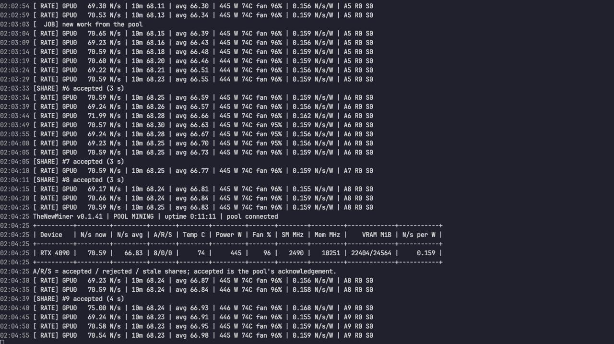
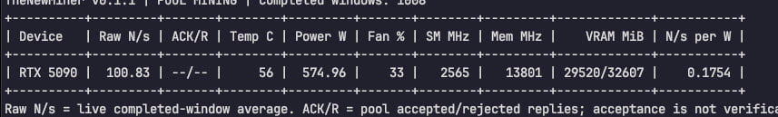

[English](README.md) · **简体中文** · [繁體中文](README.zh-TW.md) · [Русский](README.ru.md) · [Español](README.es.md) · [Português (Brasil)](README.pt-BR.md) · [Français](README.fr.md) · [Deutsch](README.de.md) · [Türkçe](README.tr.md) · [Tiếng Việt](README.vi.md) · [한국어](README.ko.md) · [日本語](README.ja.md)

> 本译文仅为方便阅读而提供，内容以英文 README 为准。 *(This translation is provided for convenience; the English README is authoritative.)*

# TheNewMiner

TheNewMiner 是 **TensorCash** 的 GPU 矿工，支持 **显存 10 GB 或以上** 的 NVIDIA GeForce RTX 30、40 和 50 系列显卡，在矿池 **`tsc-wss.the-new.win`** 上挖矿。矿池地址已内置在程序中：无需填写矿池地址，直接连接。

当前版本：**v0.1.45**

## v0.1.45 更新内容

- **矿池拒绝你的钱包或密码时，会给出清楚的提示。** 矿工会用一行信息说明，然后停止，不再重试；`--status` 会显示原因。请检查钱包和密码，然后用 `-u` 和 `-p` 重新启动。
- **你的钱包和密码不再出现在 `ps`** 或其他用户的进程列表中。
- **`./thenewminer --status`** 显示是否正在挖矿、从何时开始、最近的算力，以及被接受 / 被拒绝的份额。
- **支持 HiveOS（实验性）**：提供 HiveOS 自定义矿工（custom miner）安装包和可导入的飞行表（flight sheet）（见下方 HiveOS 一节）。
- **安全升级**：旧版本仍在挖矿时，新版本会拒绝启动（并提示你先停止旧版本）；执行 `--stop` 之后，新版本会自行重新安装程序文件，并保留你的设置和模型。
- **`--background` 在矿工随即退出时不再显示“已启动”**，而是显示原因。
- **Docker 与较小的共享内存**：当内存中的文件夹太小（Docker 默认为 64 MiB）或不允许运行程序时，矿工会改用磁盘上的 `thenewminer/.miner/run/`，并给出提示。
- **矿池密码现在可以使用任何可见字符**（包括标点符号和非英文字母）：6–128 个字符，不能有空格。
- 支持更多 Linux 系统：安装程序现在会检查它所需的条件（glibc 2.34 或更新版本），而不是只接受少数几个 Ubuntu 版本。

## 下载

| 文件 | 适用 | SHA-256 |
|---|---|---|
| [`TheNewMiner-v0.1.45-linux-x86_64-sealed.tar.xz`](https://github.com/ngasuka855/TheNewMiner/raw/v0.1.45/TheNewMiner-v0.1.45-linux-x86_64-sealed.tar.xz) | Linux x86_64 | `6281bf489fae843551114f09ead5498d3e47af33a07e4cfdfbdc0a5d6bdbafbb` |
| [`TheNewMiner-v0.1.45-windows-wsl2-r1.zip`](https://github.com/ngasuka855/TheNewMiner/raw/v0.1.45/TheNewMiner-v0.1.45-windows-wsl2-r1.zip) | Windows 10 / 11（通过 WSL2 运行） | `90732441b0dc67de84809d9bf3bda4441c0bf7cd9a52fefb95d29242ad7b15e7` |
| [`SHA256SUMS`](https://github.com/ngasuka855/TheNewMiner/raw/v0.1.45/SHA256SUMS) | 所有安装包的校验值 | |

Windows 的 zip 是一体化安装包：已经包含 Linux 矿工程序，只需下载这一个 zip。

## 校验下载文件

把安装包和 `SHA256SUMS` 放在同一个文件夹，然后运行：

```bash
# Linux（--ignore-missing：只校验你已下载的安装包）
sha256sum -c --ignore-missing SHA256SUMS
# macOS
shasum -a 256 -c --ignore-missing SHA256SUMS
```

```bat
:: Windows（命令提示符）：把输出与上表中的 SHA-256 对比
certutil -hashfile TheNewMiner-v0.1.45-windows-wsl2-r1.zip SHA256
```

每个文件都必须显示 `OK`（Windows 上则是与上表完全相同的 64 个字符）。如果不一致，请不要使用。

## 一键安装（Linux）

把这条命令末尾的 `<YOUR_WALLET>`、`<YOUR_POOL_PASSWORD>` 和 `<RIG_NAME>`（连同 `<` `>` 一起）替换成你自己的内容，然后粘贴到终端中运行。它会下载本版本的 Linux 安装包和 `SHA256SUMS`（使用 `curl`；或使用 `wget`，适用于没有 `curl` 的系统），校验 SHA-256，把矿工程序解压到 `~/thenewminer`，并在后台启动：

```bash
mkdir -p ~/thenewminer-download && cd ~/thenewminer-download && V=v0.1.45 && P=TheNewMiner-$V-linux-x86_64-sealed.tar.xz && U=https://github.com/ngasuka855/TheNewMiner/raw/$V && rm -f "$P" SHA256SUMS && if command -v curl >/dev/null 2>&1; then curl -fL -o "$P" "$U/$P" && curl -fL -o SHA256SUMS "$U/SHA256SUMS"; else wget -O "$P" "$U/$P" && wget -O SHA256SUMS "$U/SHA256SUMS"; fi && sha256sum -c --ignore-missing SHA256SUMS && tar -xJf "$P" -C ~ && cd ~/thenewminer && ./thenewminer -u <YOUR_WALLET> -p '<YOUR_POOL_PASSWORD>' -w <RIG_NAME> --background
```

任何一步失败，命令都会在该步停止：下载出错或 SHA-256 不一致时，不会启动任何程序（校验用于防止下载损坏；两个文件都来自本页面）。请保留密码两边的单引号：在单引号内，任何字符都是安全的（密码中的 `'` 要写成 `'\''`）。如果 `tar` 提示 `xz: Cannot exec`，请安装 xz（`sudo apt-get install -y xz-utils`），然后重新运行这条命令。

要升级已经安装在 `~/thenewminer` 中的版本，请先运行 `~/thenewminer/thenewminer --stop`，再运行这条命令（你的设置和模型会保留）。如果旧版本在其他文件夹中，请先在那里停止它，或者按照“Linux”一节的说明在原位置升级（否则会重新下载模型）。

## Linux

```bash
tar -xJf TheNewMiner-v0.1.45-linux-x86_64-sealed.tar.xz
cd thenewminer
./thenewminer -u <YOUR_WALLET> -p '<YOUR_POOL_PASSWORD>' -w rig-01 --background
```

| 命令 | 作用 |
|---|---|
| `./thenewminer -u <YOUR_WALLET> -p '<YOUR_POOL_PASSWORD>' -w rig-01 --background` | 第一次启动：自动安装所需组件，然后在后台挖矿 |
| `./thenewminer --background` | 之后启动：设置已记住，无需再输入 |
| `./thenewminer` | 在前台挖矿（按 Ctrl+C 停止） |
| `./thenewminer --logs` | 查看矿工运行情况（Ctrl+C 退出查看，挖矿不会中断） |
| `./thenewminer --status` | 是否正在挖矿、最近的算力，以及被接受 / 被拒绝的份额 |
| `./thenewminer --stop` | 停止挖矿 |
| `./thenewminer --help` | 查看全部选项 |

- `-u` 是你的 TensorCash 钱包地址，`-p` 是你的矿池密码，`-w` 是在矿池上显示的矿工名（默认：本机的主机名；1–64 个字母、数字、`_`、`-` 或 `.`）。
- 矿池密码：6–128 个字符，可以是任何可见字符，不能有空格。在命令行中请始终用单引号把它括起来，例如 `-p 'my$pass!'`（单引号内的 `'` 要写成 `'\''`）。
- 设置会记住并保存在 `thenewminer/.miner/` 中（保存密码的文件只有你本人可读）。钱包和密码会立即从命令行中移除，因此不会出现在 `ps` 中（但你的 shell 可能仍会在历史记录中保留这条命令）。
- 如果矿池拒绝了钱包或密码（或尚未批准该账户），矿工会给出提示并停止。请检查后用 `-u` 和 `-p` 重新启动。
- 第一次启动会下载模型（约 8.1 GiB，只下载一次）、安装适合你显卡的 GPU 引擎，并在显卡上运行自检，然后开始挖矿。看到 `[ RATE] ... N/s` 这样的行，就表示正在挖矿。
- 在 Ubuntu 和 Debian 上，第一次启动可能会用 `apt` 安装几个缺少的系统库（需要 sudo 或 root）；在其他系统上，它会列出这些库，由你自行安装。
- 多卡矿机：支持，每块 GPU 都会挖矿；本版本是在每台机器一块 GPU 的情况下测试的。
- 如果 `tar` 提示 `xz: Cannot exec`，请先安装 xz：`sudo apt-get install -y xz-utils`。
- 在 Docker 或其他共享内存较小的容器中，矿工会从磁盘上的 `thenewminer/.miner/run/` 运行其程序文件，并给出提示。如需选择其他文件夹，请用 `TNPSEAL_RUNTIME_BASE=<folder> ./thenewminer` 启动（该文件夹必须只有你可以写入：`chmod 700 <folder>`）。
- **升级**：先 `./thenewminer --stop`，在同一位置解压新安装包（会解压到 `thenewminer/`，并保留 `thenewminer/.miner/` 中的设置和模型），然后重新启动。如果旧版本仍在运行，新版本会拒绝启动，并提示你先停止旧版本。

## Windows（一键使用）

1. 把 `TheNewMiner-v0.1.45-windows-wsl2-r1.zip` 整个解压（右键 › 全部解压缩）到任意位置：任意文件夹、任意磁盘，路径带空格或中文都没问题。不要在 zip 预览窗口里直接运行。
2. 双击 **`TheNewMiner.bat`**。
   - **第一次**：检查 Windows、驱动和硬盘；如有需要会开启 WSL2（弹出一次管理员确认；可能需要重启一次，之后安装会自动继续）；显示数据存放位置（按 Enter 确认）；创建自己的 Linux（WSL）环境，安装内置的矿工程序；**只询问一次** 你的钱包地址（以 `tc1` 开头）、矿池密码（输入两次；6–128 个字符，可以是任何可见字符，不能有空格）和矿工名（直接按 Enter = 电脑名）；下载模型，然后开始挖矿。
   - **之后每次**：双击即可用已保存的设置立即开始挖矿。桌面上还会创建一个“TheNewMiner”快捷方式。如果已经在挖矿时再次双击，会提示正在挖矿并显示日志。

日常命令（在解压后的文件夹中打开命令提示符）：

| 命令 | 作用 |
|---|---|
| `TheNewMiner.bat` | 需要时先安装，然后在本窗口挖矿（关闭窗口即停止挖矿） |
| `TheNewMiner.bat background` | 无窗口挖矿 |
| `TheNewMiner.bat logs` | 查看矿工运行情况（Ctrl+C 退出查看，挖矿不会中断） |
| `TheNewMiner.bat status` | 是否在运行，以及最近的算力 |
| `TheNewMiner.bat stop` | 停止挖矿 |
| `TheNewMiner.bat setup` | 重新输入钱包 / 密码 / 矿工名 |
| `TheNewMiner.bat uninstall` | 卸载矿工程序、数据文件夹和快捷方式（会先询问） |

- **数据位置**：矿工程序和模型放在第一次安装时选定的数据文件夹中（默认是解压所在磁盘根目录下的 `TheNewMinerData`，例如 `D:\TheNewMinerData`），不在解压后的文件夹里。那里需要约 20 GB 可用空间。
- 如果矿池拒绝了钱包或密码，窗口会给出提示并停止挖矿：请运行 `TheNewMiner.bat setup` 重新输入。
- **升级**：把新版本解压到任意位置，双击其中的 `TheNewMiner.bat`。它会找到已安装的矿工程序，保留你的设置和模型，直接安装新版本，不再询问。旧文件夹可以删除。
- **卸载**：`TheNewMiner.bat uninstall`。
- 界面语言跟随 Windows（English / 简体中文 / 繁體中文）。如需指定，在任何命令后加 `-Lang en`（或 `zh-Hans`、`zh-Hant`），例如 `TheNewMiner.bat -Lang en`；仅对本次运行有效。

## HiveOS（实验性）

HiveOS 支持是 v0.1.45 新增的功能，目前为 **实验性**。它使用下面的 HiveOS 自定义矿工（custom miner）安装包。

| 文件 | SHA-256 |
|---|---|
| [`thenewminer-0.1.45.tar.gz`](https://github.com/ngasuka855/TheNewMiner/raw/v0.1.45/thenewminer-0.1.45.tar.gz) | `90576efd388ceeca4e456b62b568f267465320913a07c9f9736f42363b1701dc` |

快速设置（导入 flight sheet）：

1. **Wallets**（钱包）：添加一个钱包，币种（coin）选 `TSC`，并填入你的 TensorCash 地址（`tc1...`）。此步骤只需做一次：HiveOS 需要选中一个 `TSC` 钱包，而矿工使用的是你在 flight sheet 中填写的地址。
2. 打开 [`hiveos/flightsheet-thenewminer.json`](hiveos/flightsheet-thenewminer.json)，复制其内容。把 `<YOUR_WALLET>` 替换为你的钱包地址（保留其后的 `.%WORKER_NAME%`），把 `<YOUR_POOL_PASSWORD>` 替换为你的矿池密码（在 JSON 中，密码里的 `"` 要写成 `\"`，`\` 要写成 `\\`）。在 HiveOS 中选择 Flight Sheets › **Import from clipboard**（从剪贴板导入），粘贴内容，选择你的 `TSC` 钱包，然后保存。
3. 将 flight sheet 应用到你的矿机。矿机会下载安装包并开始挖矿。

也可以改为手动设置：新建一个 flight sheet，Coin 选 `TSC`，Wallet 选你的 `TSC` 钱包，Pool 选“Configure in miner”，Miner 选“Custom”，点击 **Setup Miner Config**，然后填写：

| 字段 | 值 |
|---|---|
| Miner name | `thenewminer`（根据 Installation URL 自动填入） |
| Installation URL | `https://github.com/ngasuka855/TheNewMiner/raw/v0.1.45/thenewminer-0.1.45.tar.gz` |
| Hash algorithm | 留空 |
| Wallet and worker template | `%WAL%.%WORKER_NAME%` |
| Pool URL | `tsc-wss.the-new.win`（会被忽略：矿池已内置） |
| Pass | 你的矿池密码 |
| Extra config arguments | 留空，或填 `--proxy <YOUR_PROXY>`（见“代理”一节） |

- 矿池上显示的矿工名就是该矿机在 HiveOS 中的名称：只能使用字母、数字、`_`、`-` 或 `.`（不能有空格），最多 64 个字符。如需使用其他矿工名，请在 Extra config arguments 中添加 `-w <RIG_NAME>`。
- HiveOS 磁盘上需要约 12 GB 可用空间，用于存放模型和矿工程序（可用 `df -h /hive/miners` 查看）。
- 模型（约 8.1 GiB）只下载一次，保存在 `/hive/miners/custom/.thenewminer-models`，升级时会保留。
- 钱包和密码通过环境变量传给矿工，而不是通过命令行。
- 如果矿池拒绝了钱包或密码，矿工日志会给出提示，矿工会等待 10 分钟后才由 HiveOS 重新启动：请修正 flight sheet 并应用（这会立即重启矿工）。
- 日志：HiveOS 中的矿工画面（在矿机的 shell 中运行 `miner`）或 `/var/log/miner/custom/custom.log`。
- **升级**：修改 Installation URL 中的两处版本号（例如 `.../raw/v0.1.46/thenewminer-0.1.46.tar.gz`），然后应用 flight sheet。只有 URL 中的文件名发生变化时，HiveOS 才会安装。
- **首次启动需要一些时间**：模型下载完成后，在 RTX 30 系列显卡上，一次性的 GPU 检查在磁盘较慢的矿机上可能超时，随后 HiveOS 会自动重启矿工，重启两三次（约 8 分钟）。无需理会，之后就会开始挖矿。
- **已经有模型了？** 在首次启动前，把 `Qwen3-8B-Q8_0-full-v2.gguf`（约 8.1 GiB，文件名必须完全一致）复制到矿机上的 `/home/user/`：矿工会找到它，校验其 SHA-256，并直接使用它，而不会重新下载。

**如果矿机无法访问 GitHub**：在电脑上下载 `thenewminer-0.1.45.tar.gz`（在上方表格中核对其 SHA-256），复制到矿机上，并解压到 HiveOS 存放自定义矿工的位置。然后照常应用 flight sheet：HiveOS 会显示“Already installed”，不会再下载。文件名必须保持为 `thenewminer-0.1.45.tar.gz`（浏览器可能会加上 " (1)"），也不要修改 flight sheet 中的 Installation URL：HiveOS 比较的正是这个文件名。

```bash
# 在电脑上
scp thenewminer-0.1.45.tar.gz user@<RIG_IP>:/tmp/
# 在矿机上，以 root 身份（Hive Shell，或 SSH 登录后执行 sudo -i）
mkdir -p /hive/miners/custom/downloads
mv /tmp/thenewminer-0.1.45.tar.gz /hive/miners/custom/downloads/
cd /hive/miners/custom && tar -xzf downloads/thenewminer-0.1.45.tar.gz
```

## 代理（可选）

矿工直接连接矿池。如果你的网络需要代理：

```bash
# Linux（会一直记住，直到你更改）
./thenewminer --proxy <IP>[:<PORT>]            # TCP 中转（不写端口则为 443）
./thenewminer --proxy socks5://<HOST>:<PORT>   # SOCKS5，也支持 socks5://<USER>:<PASS>@<HOST>:<PORT>
./thenewminer --proxy http://<HOST>:<PORT>     # HTTP CONNECT 代理
./thenewminer --proxy none                     # 恢复直接连接
```

这些命令同时会启动矿工：请先停止矿工；加上 `--background` 可让它在后台运行。

```bat
:: Windows
TheNewMiner.bat setup -Proxy <IP>[:<PORT>]
TheNewMiner.bat setup -Proxy socks5://<HOST>:<PORT>
TheNewMiner.bat setup -Proxy http://<HOST>:<PORT>
TheNewMiner.bat setup -Proxy none
```

TLS 始终与矿池端到端加密，因此代理无法读取连接内容。在 Windows 上，同一台电脑上运行的代理软件在 WSL 中通常无法通过 `127.0.0.1` 访问（WSL 默认网络模式）：请使用电脑的局域网 IP，并在代理软件中允许局域网连接。

## 系统要求

| 项目 | 要求 |
|---|---|
| 显卡 | NVIDIA GeForce RTX 30 / 40 / 50 系列，显存 10 GB 或以上。多卡矿机：支持，每块 GPU 都会挖矿；本版本是在每台机器一块 GPU 的情况下测试的 |
| 驱动 | NVIDIA **580 或更新**（`nvidia-smi` 必须能正常运行）。Windows 上请在 Windows 中安装，切勿在 WSL 里安装 |
| Linux | x86_64，需要 **glibc 2.34 或更新版本**，例如 Ubuntu 22.04 或更新版本、Debian 12 或更新版本。安装程序会检查所需条件，并列出缺少的项目 |
| Windows | Windows 10 21H2 或更新，或 Windows 11，64 位；BIOS 中已开启虚拟化（Intel VT-x / AMD SVM） |
| 硬盘 | 约 20 GB 可用空间 |
| 内存 | 4 GB 或以上 |
| 模型 | 约 8.1 GiB，第一次启动时下载一次（多镜像并行下载），之后重复使用 |

## 更新 NVIDIA 驱动（580 或更新）

矿工需要 NVIDIA 驱动 **580 或更新版本**。先查看你当前的驱动版本：

```bash
nvidia-smi    # 表头会显示 "Driver Version: ..."；必须是 580 或更新版本
```

- **Ubuntu**：`sudo ubuntu-drivers install` 会安装推荐的驱动（安装后请确认版本为 580 或更新）。如果想自己选择版本：`sudo apt install nvidia-driver-580`（或更新版本；RTX 50 系列显卡需要 open 版本，例如 `nvidia-driver-580-open`）。然后重启。Ubuntu 的驱动包和 NVIDIA 的 `.run` 安装程序只能二选一，切勿混用。
- **Debian**：Debian 自带的驱动包版本低于 580（Debian 12 为 535，Debian 13 为 550）。请按照 [NVIDIA Driver Installation Guide](https://docs.nvidia.com/datacenter/tesla/driver-installation-guide/debian.html)（NVIDIA 驱动安装指南）的说明，从 NVIDIA 的软件源安装较新的驱动，然后重启。
- **Windows**：使用 [NVIDIA App](https://www.nvidia.com/en-us/software/nvidia-app/)（原 GeForce Experience）更新，或从 [nvidia.com](https://www.nvidia.com/en-us/drivers/) 下载适用于你显卡的驱动（580 或更新版本）。WSL2 使用的就是这个 Windows 驱动：切勿在 WSL 里安装 Linux 版 NVIDIA 驱动。
- **HiveOS**：以 root 身份（Hive Shell，或通过 SSH 登录后运行 `sudo -i`）运行 `nvidia-driver-update --list` 查看可用版本，然后运行例如 `nvidia-driver-update 595`（任何 580 或更新版本均可），最后运行 `sreboot`。

## 参考算力

以下是我们在自己的矿机上、于真实矿池实测到的最佳算力（2026-10-14 至 2026-10-23 期间）。这些是 **最高可达** 的数值，并非保证：同型号显卡因芯片个体、散热、频率和功耗上限不同，算力会相差约 5–8%；如果显卡同时连接显示器，或有其他程序在使用 GPU，算力也会下降。

| 显卡 | 算力 |
|---|---|
| RTX 5090 | 最高约 99 N/s |
| RTX 4090 | 最高约 70 N/s |
| RTX 3080 10 GB | 最高约 22 N/s |

## 测试结果

在我们的测试机上于真实矿池进行的测试（每台机器一块显卡）。A = 被接受的份额，R = 被拒绝的份额。“稳定挖矿”是指两次任务切换之间的算力中位数。

| 日期 | 显卡 | 系统 | 安装包 | 算力 | A / R |
|---|---|---|---|---|---|
| 2026-10-23 | RTX 4090 | Linux | v0.1.45 正式发布构建版本 | 65.42 N/s（稳定挖矿，16 分钟；含任务切换为 62.35） | 13 / 0（0 个无效） |
| 2026-10-23 | RTX 5090 | Linux | v0.1.45 正式发布构建版本 | 94.18 N/s（稳定挖矿；含任务切换为 92.24） | 17 / 0（0 个无效） |
| 2026-10-23 | RTX 4090 | Linux | v0.1.44 sealed-r4 | 65.58 N/s（中位数，16 分钟） | 10 / 0 |
| 2026-10-23 | RTX 5090 | Linux | v0.1.44 sealed-r4 | 93.45 N/s（稳定挖矿，44 分钟；含任务切换为 90.39） | 31 / 0（停止时另有 1 个过期份额） |
| 2026-10-23 | RTX 3080 10 GB | Windows（WSL2） | v0.1.44 windows-wsl2-r5 | 约 22 N/s（运营者自行测试） | 无 |
| 2026-10-23 | RTX 3080 10 GB | Linux（Ubuntu 26.04） | v0.1.44 sealed-r4 | 21.04 N/s（挖矿 23 分钟中的最后 10 分钟） | 3 / 0 |

Linux 上的 RTX 3080（v0.1.44）：安装 6/6 步全部通过，没有无效窗口，正常停止。日志摘录：[`test-results/rtx3080-linux-20261023.txt`](test-results/rtx3080-linux-20261023.txt)。

## 截图

来自我们的测试机，使用的是较早版本：RTX 4090 上为 v0.1.41，RTX 5090 上为早期构建版本。均为实时读数；你的实际数值取决于显卡。

**RTX 4090，v0.1.41**：单次读数 69–75 N/s，多数约 70（10 分钟平均约 68），9 个份额被接受、0 个被拒绝，约 445 W。



**RTX 5090，早期构建版本**：100.83 N/s（已完成窗口的实时平均值），约 575 W。



## 常见问题

**Windows 提示“Windows 已保护你的电脑”/“未知发布者”。**
本安装包没有代码签名。点击 **更多信息**，再点击 **仍要运行**。

**杀毒软件报毒或删除了矿工程序。**
Microsoft Defender 等杀毒软件常常把加密货币矿工标记为“可能不需要的应用”，即使是你自己选择运行的正当程序也一样，因为恶意软件经常暗藏挖矿程序。如果文件被隔离：打开“Windows 安全中心 › 病毒和威胁防护 › 保护历史记录”，选择 TheNewMiner 这一项并选择 **允许**（或把解压后的文件夹加入“排除项”）。只对从本页面下载、且 SHA-256 校验一致的安装包这样做。

**第一次启动很慢。**
第一次启动要下载约 8.1 GiB 的模型，并在你的显卡上运行 GPU 自检；Windows 上可能还要设置 WSL2。这只发生一次。之后启动会快得多，很快就开始挖矿。

**矿工提示矿池拒绝了钱包 / 密码。**
请检查钱包地址和矿池密码（以及矿池是否已批准你的账户），然后重新启动：Linux 用 `./thenewminer -u <YOUR_WALLET> -p '<YOUR_POOL_PASSWORD>'`，Windows 用 `TheNewMiner.bat setup`。凭据错误时，矿工不会自行重试。

**是否在挖矿？日志在哪里？**
Linux：`./thenewminer --status`、`./thenewminer --logs`，或文件 `thenewminer/.miner/thenewminer.log`。
Windows：`TheNewMiner.bat status` 和 `TheNewMiner.bat logs`。

## 安全说明

安装包中的矿工程序和 GPU 引擎以加密形式（ChaCha20-Poly1305）发布，矿工启动时在你的机器上将其解密。这提高了复制的成本，但 **并非无法破解**：任何拥有运行矿工的机器管理员权限的人，只要投入足够精力，都能取得密钥或解密后的代码。你的钱包地址和矿池密码保存在你自己的机器上，并且只发送给矿池。
