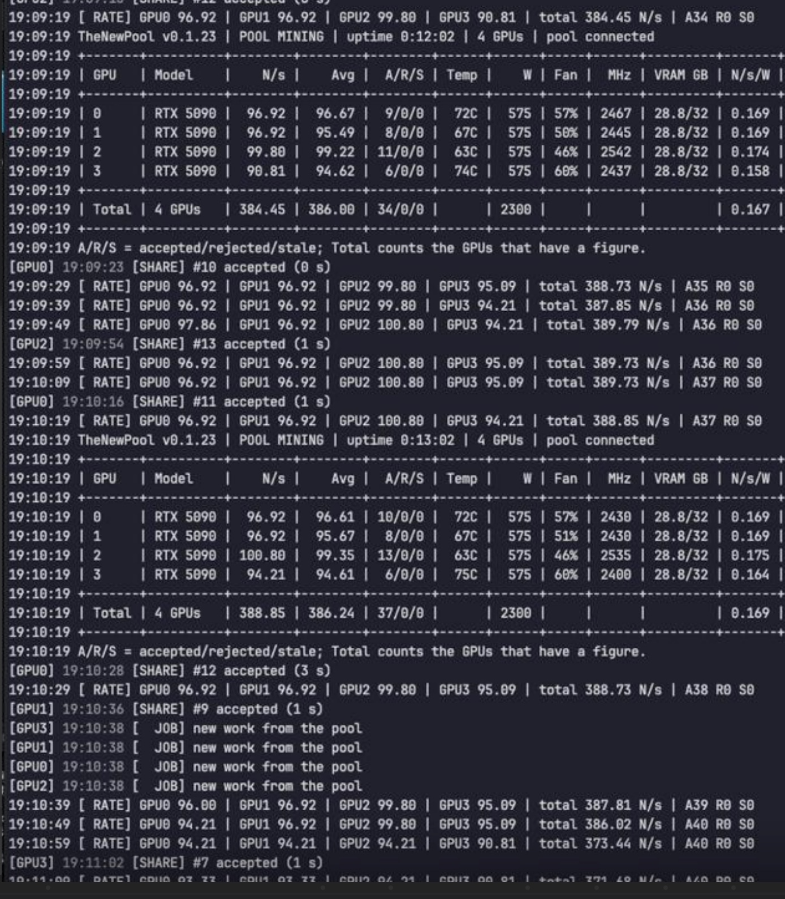

# Development record

A short timeline of TheNewMiner's public milestones. Rates are real-pool measurements on our own test rigs (one card
model at a time); they are not a promise for every card. The dated details are in the [test results](TEST-RESULTS.md),
the changes of each version in [`releases/`](releases/).

| Date | Milestone |
|---|---|
| 2026-10-07 | First share accepted by the pool from the project's own inference engine, on an RTX 5090 |
| 2026-10-11 | RTX 4090 above 60 N/s on the real pool |
| 2026-10-14 | 4× RTX 5090 rig: ~386–389 N/s in total, 0 rejected (screenshot below) |
| 2026-10-23 | v0.1.44: the sealed (encrypted) package and the one-click Windows zip (WSL2), first public release |
| 2026-10-23 | v0.1.45: HiveOS package (experimental), first run on a real HiveOS rig |
| 2026-10-23 | v0.1.46: sturdier first start on RTX 30 series cards and HiveOS, smoother waves |
| 2026-10-28 | v0.1.47: simpler install: credentials checked before the download, Windows account asked once, upgrade in place |

## Rates per version

| Version | RTX 5090 | RTX 4090 | RTX 3080 10 GB |
|---|---|---|---|
| v0.1.44 | 93.45 N/s | 65.58 N/s | 21.04 N/s (Linux), ~22 N/s (Windows) |
| v0.1.45 | 94.18 N/s | 65.42 N/s | |
| v0.1.46 | 95.41 N/s | 66.23 N/s | |
| v0.1.47 | 93.57 N/s | 69.28 N/s | 21–22 N/s (Windows) |

In short: an RTX 5090 mines at about 95 N/s, an RTX 4090 at about 66–69 N/s and an RTX 3080 10 GB at about 21 N/s.
The 5090 rows come from different cards and sessions (on the same card in the same session, v0.1.47 matched v0.1.46).

## Milestone screenshot

An early build (v0.1.23, under the project's earlier name) on a 4× RTX 5090 rig: ~386–389 N/s total, 37 accepted / 0
rejected / 0 stale after 13 min.
